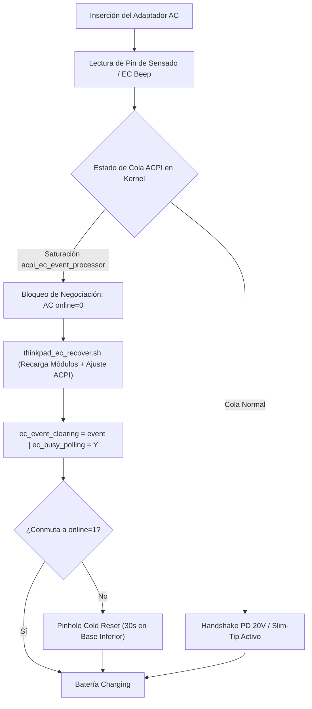

# ThinkPad EC & Power Delivery Sentinel

Herramienta de telemetría, auditoría forense y recuperación en caliente para subsistemas de energía (Embedded Controller, ACPI, USB-PD y drivers de batería) en portátiles Lenovo ThinkPad (series P, T, X) sobre Linux.

## Arquitectura de Diagnóstico y Mitigación



```text
┌───────────────────────────────────────────────────────────────┐
│                 Inserción del Adaptador AC                    │
└───────────────────────────────┬───────────────────────────────┘
                                │
                                ▼
┌───────────────────────────────────────────────────────────────┐
│            Lectura de Pin de Sensado / EC Beep                │
└───────────────────────────────┬───────────────────────────────┘
                                │
                                ▼
┌───────────────────────────────────────────────────────────────┐
│             Estado de Cola ACPI en Kernel                     │
└───────────────┬───────────────────────────────┬───────────────┘
                │                               │ Normal
                ▼ Saturada                      ▼
┌──────────────────────────────┐ ┌──────────────────────────────┐
│  Bloqueo: AC online = 0      │ │  Handshake PD 20V / Slim-Tip │
└───────────────┬──────────────┘ └──────────────┬───────────────┘
                │                               │
                ▼                               │
┌──────────────────────────────┐                │
│    thinkpad_ec_recover.sh    │                │
│ (Recarga drivers + ACPI tune)│                │
└───────────────┬──────────────┘                │
                │                               │
                ▼                               │
┌──────────────────────────────┐                │
│     ¿Conmuta a online=1?     │                │
└───────┬──────────────┬───────┘                │
        │ Sí           │ No                     │
        │              ▼                        │
        │ ┌──────────────────────────────┐      │
        │ │   Pinhole Cold Reset (30s)   │      │
        │ └────────────┬─────────────────┘      │
        │              │                        │
        ▼              ▼                        ▼
┌───────────────────────────────────────────────────────────────┐
│                      Batería Charging                         │
└───────────────────────────────────────────────────────────────┘
```

## Características Técnicas

- **Telemetría no destructiva**: Inspección directa de nodos `sysfs` (`/sys/class/power_supply/`, `/sys/class/typec/`, `/sys/module/acpi/parameters/`).
- **Detección de tormentas de eventos EC**: Rastreo en logs de kernel de bloqueos en `acpi_ec_event_processor`.
- **Ajuste dinámico ACPI**: Conmutación de `ec_event_clearing` a modo `event` y activación de `ec_busy_polling` para erradicar retrasos de interrupción tras suspensión S3.
- **Normalización de umbrales**: Limpieza de registros corruptos en `charge_control_start_threshold` y `charge_control_end_threshold`.
- **Blindaje Kernel anti-bloqueo BIOS**: Resuelve el desbordamiento de eventos sin necesidad de alterar menús UEFI en equipos con contraseña de supervisor bloqueada.

## Blindaje Permanente sin Acceso a BIOS (Supervisor Password Workaround)

En equipos adquiridos de segunda mano con contraseña de supervisor en el BIOS/UEFI, el blindaje se ejecuta 100% en el plano del kernel Linux:

### 1. Parámetros de Arranque en GRUB
```bash
sudo sed -i 's/GRUB_CMDLINE_LINUX_DEFAULT="/GRUB_CMDLINE_LINUX_DEFAULT="acpi.ec_event_clearing=event acpi.ec_busy_polling=1 /' /etc/default/grub
sudo update-grub
```

### 2. Hook de Reanudación Systemd-Sleep
```bash
sudo tee /lib/systemd/system-sleep/99_thinkpad_power_resume.sh << 'EOF'
#!/bin/sh
case "$1" in
  post)
    udevadm trigger --subsystem-match=power_supply
    udevadm trigger --subsystem-match=typec
    ;;
esac
EOF
sudo chmod +x /lib/systemd/system-sleep/99_thinkpad_power_resume.sh
```

## Uso Rápido

### 1. Auditoría de Telemetría (Python)

```bash
# Reporte en texto plano
python3 -m src.sentinel

# Salida estructurada en JSON
python3 -m src.sentinel --json
```

### 2. Remediación en Caliente (Bash / Root)

```bash
sudo ./scripts/thinkpad_ec_recover.sh
```

### 3. Pruebas Unitarias

```bash
python3 -m unittest discover -s tests -v
```

## Protocolo de Reseteo Físico por Hardware (Pinhole Reset)

Si el Embedded Controller mantiene energía residual en compuertas tras fallos críticos:

1. Apagar el equipo por completo (`sudo poweroff`) y desconectar el cargador.
2. Insertar un clip en el orificio **Emergency Reset Hole** ubicado en el panel inferior durante **30 segundos continuos**.
3. Mantener presionado el botón de encendido frontal durante **30 segundos** sin fuente conectada (drenaje capacitivo).
4. Reconectar el cargador y encender.

## Licencia

Distribuido bajo licencia MIT. Autor: Moises Mansilla F. (mmansillaf@gmail.com).
